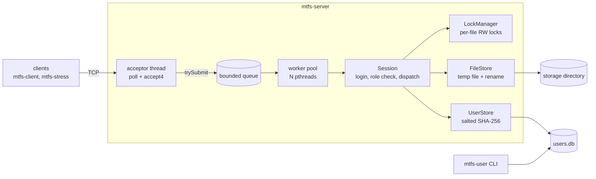

# Multithreaded File Server

**Context.** Course project, February–April 2026, B.Tech. Data Science & AI, IIT Roorkee. By Samyak Ajmera, Tarun Aryan, Amritanshu Tiwari and Vidit Aggarwal ([who did what](#team)). The original code was not kept after submission, so this repository is a rebuild of our design, published to GitHub in October 2026.

[](https://github.com/Samyak336/multithreaded-file-server/actions/workflows/ci.yml)

A concurrent TCP file server written in C++17 on POSIX sockets and pthreads. Many clients can upload, download, append to, copy and rename files at the same time. Per-file reader-writer locks built from semaphores keep the files consistent, and a global lock order makes the server deadlock-free. Users log in against salted SHA-256 password hashes (OpenSSL) and are limited by role.

## Highlights

- **Thread pool with a bounded queue.** A fixed set of pthread workers serves client sessions. When every worker is busy and the queue is full, a new client gets an immediate `503` instead of hanging.
- **Fair reader-writer lock per file**, built from three POSIX semaphores (the starvation-free readers-writers solution), so a steady stream of readers cannot starve a writer.
- **Deadlock-free by lock ordering.** Operations on two files lock them in sorted order. With the sort disabled, the deadlock test hangs, which shows the ordering is what prevents deadlock.
- **No write lock is held during a network transfer.** Uploads stream into a temporary file first, and an atomic `rename(2)` publishes them under the lock.
- **Role-based access control** (`reader` < `writer` < `admin`), enforced in one table-driven dispatcher.
- **Salted SHA-256** through OpenSSL's EVP API, a constant-time hash comparison, the same hashing work for unknown user names, and a disconnect after three failed logins.
- **Checked under ThreadSanitizer and AddressSanitizer/UBSan in CI**, plus a stress tool that verifies every read. On a laptop, 32 clients ran 431k operations in 10 s with 0 corrupt reads.

## Architecture



| Module | Contents |
|---|---|
| [`src/common`](src/common) | socket RAII and buffered message framing (`net`), the wire protocol (`protocol`), pthread mutex/condvar/semaphore wrappers (`sync.hpp`), logger, password prompt |
| [`src/auth`](src/auth) | OpenSSL hashing (`crypto`), the role hierarchy (`role`), the user database (`user_store`) |
| [`src/server`](src/server) | accept loop and shutdown (`server`), worker pool (`thread_pool`), per-client protocol and role checks (`session`), lock table (`lock_manager`), reader-writer lock (`rw_lock`), storage (`file_store`) |
| [`src/client`](src/client) | client library and the interactive `mtfs-client` |
| [`tools`](tools) | `mtfs-user` (user administration) and `mtfs-stress` (load generator and consistency checker) |
| [`tests`](tests) | unit tests and end-to-end tests |

Each module is its own CMake static library, and executables link only what they use (the client never links OpenSSL). A new module is one `add_subdirectory` line.

## Concurrency design

### Threading model

The main thread is the acceptor. It `poll()`s the listening socket and a wake-up pipe, `accept4()`s new connections, and hands each one to the `ThreadPool` with a non-blocking `trySubmit()`. The pool is a classic producer-consumer: a `std::deque` of jobs guarded by a pthread mutex and condition variable, consumed by N worker threads.

A worker serves one client for the whole session, from `LOGIN` to `QUIT`, so the number of workers is the maximum number of concurrent sessions. A fixed pool keeps the thread count and memory bounded during connection bursts. Thread-per-connection would create one thread (and one stack) for every client that shows up. Socket timeouts (`SO_RCVTIMEO`/`SO_SNDTIMEO`, `--idle-timeout`) make sure an idle or stalled client cannot hold a worker, or a file lock, forever.

### A fair reader-writer lock from semaphores

```text
lockRead:    turnstile.P  countMutex.P  if (++readers == 1) resource.P  countMutex.V  turnstile.V
unlockRead:  countMutex.P  if (--readers == 0) resource.V  countMutex.V
lockWrite:   turnstile.P  resource.P  turnstile.V
unlockWrite: resource.V
```

- In the simpler readers-preference solution, overlapping readers keep `readers > 0` forever and a writer starves. Here a waiting writer keeps the `turnstile`, so readers that arrive after it queue behind it ([`rw_lock.cpp`](src/server/rw_lock.cpp)).
- `resource` has to be a semaphore, not a mutex. The first reader of a group acquires it and the last reader releases it, which is usually a different thread, and a pthread mutex may only be unlocked by its owner.
- POSIX does not promise FIFO wake-up order among threads blocked on one semaphore. The guarantee is that writers are not starved, not strict arrival order.

### The lock table

[`LockManager`](src/server/lock_manager.hpp) maps a file name to `{RWLock, users}`. An entry is created on first use and erased when `users` (holders plus waiters) drops to zero, so memory grows with the number of files in use, not with every file ever touched. The table's own mutex is held only to look up an entry and adjust its count, never while waiting for a file lock.

### Why it cannot deadlock

A deadlock needs all four Coffman conditions: mutual exclusion, hold-and-wait, no preemption and circular wait. The design removes circular wait:

1. Single-file commands hold exactly one lock, so they never hold one lock while waiting for another.
2. `COPY` and `RENAME` need two locks and get them through one `acquireAll()` call, which sorts the names. With every thread acquiring in the same total order, nobody can hold a "larger" name while waiting for a "smaller" one, so no cycle can form.
3. Duplicate names are merged (`RENAME a a`). Otherwise a thread would wait on a non-recursive lock it already holds.
4. The table mutex is a leaf lock, never held while blocking.
5. RAII guards release every lock on every path: early returns, exceptions and dropped connections.

[`test_lock_manager`](tests/test_lock_manager.cpp) runs 8 threads × 5,000 two-lock acquisitions in opposite orders, the textbook deadlock recipe. It passes in about a second. With the sort removed, it hangs until the watchdog kills it.

### What each command locks

| Command | Locks | Held while |
|---|---|---|
| `LIST` | none | (a directory listing is a point-in-time snapshot) |
| `STAT f` | read `f` | `stat` runs |
| `GET f` | read `f` | the whole download is sent |
| `PUT f n` | write `f` | only the final `rename`; the upload itself goes to a temp file with no lock held |
| `APPEND f n` | write `f` | data is copied from the already-received temp file onto `f` |
| `COPY a b` | read `a`, write `b` (sorted) | `a` is copied to a temp file that is renamed to `b` |
| `RENAME a b` | write `a`, write `b` (sorted) | `rename` runs |
| `DELETE f` | write `f` | `unlink` runs |

The rule behind the table: any operation that changes what a name refers to takes that name's write lock, and data arriving from the network is fully received before any lock is taken. `COPY` and `RENAME` refuse to overwrite an existing target (`409`). Their "does the target exist?" check is race-free because they hold the target's write lock, and `PUT` needs the same lock to create a file.

Stored bytes are never overwritten in place: `PUT` and `COPY` write a new file and `rename()` it over the old one, and `APPEND` only adds bytes at the end. A failed append is truncated back, so it is all-or-nothing.

### Graceful shutdown

- `SIGINT` and `SIGTERM` are blocked before any thread starts, and a dedicated thread receives them with `sigwait()`. Shutdown therefore runs as ordinary code, not inside an async signal handler, where locking a mutex is unsafe.
- `stop()` sets `stopping_` and calls `shutdown(SHUT_RDWR)` on every active client socket under the mutex that sessions register under. Blocked `recv()` calls return end-of-stream, and sessions still in the queue see `stopping_` and get `503`. A byte written to a self-pipe wakes the acceptor's `poll()`.
- **fd reuse race:** a session removes its fd from the registry *before* closing it. Otherwise `stop()` could `shutdown()` an fd number the kernel had already reused for a new connection.
- `send(..., MSG_NOSIGNAL)` (plus `SIG_IGN`) means a client that disappears mid-download produces `EPIPE` instead of a `SIGPIPE`, which would kill the server.

## Authentication and access control

- The user database is a text file of `name:role:salt:hash` lines. The salt is 16 bytes from `RAND_bytes`, and the hash is SHA-256(salt ‖ password) computed with `EVP_Digest`. The salt makes equal passwords hash differently and defeats precomputed tables.
- On login, the hash comparison uses `CRYPTO_memcmp` (constant time). An unknown user name still costs one hash, so response timing does not reveal which names exist. Three failed logins close the connection.
- The file is written as a temp file, `fsync`ed and `rename`d into place, with mode `0600`. The server re-reads it on every login, so `mtfs-user` changes apply immediately without a restart, and a concurrent reader never sees half a file. `mtfs-user` takes an exclusive `flock()` so two admin commands cannot lose each other's update.
- Roles are a hierarchy, checked in one place: the dispatcher's command table maps each verb to the action it performs, and `isAllowed(role, action)` runs before any handler.

| Role | `LIST` `STAT` `GET` | `PUT` `APPEND` `COPY` `RENAME` | `DELETE` |
|---|:---:|:---:|:---:|
| reader | ✓ | | |
| writer | ✓ | ✓ | |
| admin | ✓ | ✓ | ✓ |

- File names must match `[A-Za-z0-9._-]{1,255}` and must not start with a dot. With no `/` allowed, `../../etc/passwd` cannot escape the storage root, and the server's own temp files (`.upload-*`) stay invisible. Opens use `O_NOFOLLOW`.

## Protocol

Requests are single text lines. Anything binary travels as a raw payload whose length was announced first, so the receiver always knows where a message ends. TCP is a byte stream with no message boundaries, which is why both sides read through a buffered `Connection` class.

```text
C: LOGIN walt writer-pass
S: OK writer
C: PUT notes.txt 12
S: CONTINUE
C: <12 raw bytes>
S: OK stored 12 bytes
C: GET notes.txt
S: DATA 12
S: <12 raw bytes>
C: DELETE notes.txt
S: ERR 403 DELETE needs the admin role; you are writer
C: QUIT
S: OK bye
```

Uploads are two-phase (`CONTINUE`, like HTTP's `100-continue`). The server validates the name, size and role before the client sends a single byte. A rejected upload wastes no bandwidth, and it never leaves payload bytes on the wire that the server would then misread as commands. Errors use HTTP-style codes: `400 401 403 404 408 409 413 500 503`. Header lines are capped at 4 KiB and uploads at `--max-upload-mb`.

## Build and run

Requirements: Linux (on Windows, use WSL), g++ 9 or newer, CMake 3.20+, and the OpenSSL development package.

```bash
sudo apt install build-essential cmake libssl-dev
cmake -S . -B build
cmake --build build -j
ctest --test-dir build --output-on-failure
```

```bash
./build/bin/mtfs-user add alice admin           # prompts for a password (stored in data/users.db)
./build/bin/mtfs-server --port 9090             # serves files from data/files
./build/bin/mtfs-client --port 9090 --user alice    # in a second terminal
mtfs> put report.pdf
mtfs> ls
```

For a guided tour with three users and role checks, run `scripts/demo.sh`.

| Server option | Default | |
|---|---|---|
| `--port` | 9090 | `0` picks a free port |
| `--root` / `--users` | `data/files` / `data/users.db` | storage directory and user database |
| `--workers` / `--queue` | 16 / 64 | concurrent sessions / connections allowed to wait |
| `--max-upload-mb` | 64 | larger uploads are refused with `413` before any data is sent |
| `--idle-timeout` | 300 s | idle clients are disconnected with `408` |
| `--verbose` | off | logs every request |

Client commands: `login`, `whoami`, `ls`, `stat`, `cat`, `get`, `put`, `append`, `cp`, `mv`, `rm`, `help`, `quit`.

## Testing

| Suite | Checks |
|---|---|
| [`test_rw_lock`](tests/test_rw_lock.cpp) | readers really overlap; a writer excludes everyone (a plain counter that ThreadSanitizer would flag); a writer is not starved by overlapping readers |
| [`test_lock_manager`](tests/test_lock_manager.cpp) | opposite-order lock storms finish; mixed read/write modes; duplicate names merge; files lock independently; guard moves; the table empties |
| [`test_auth`](tests/test_auth.cpp) | SHA-256 known-answer vectors; distinct salts; user DB round trip; no plaintext on disk; malformed databases rejected |
| [`test_file_store`](tests/test_file_store.cpp) | name validation, including traversal attempts; atomic commit and append; copy/rename conflicts; stale temp files removed at startup |
| [`test_end_to_end`](tests/test_end_to_end.cpp) | a real server and TCP clients: role checks, three-strikes login, binary round trip, `413` leaves the connection usable, oversized headers, 16 concurrent appenders (every record whole and in order), `503` backpressure, idle timeout, shutdown waking blocked sessions |

CI ([`ci.yml`](.github/workflows/ci.yml)) builds and runs everything three times (plain Release, ThreadSanitizer, AddressSanitizer + UBSan), each followed by a stress run.

### Stress results

[`mtfs-stress`](tools/mtfs_stress.cpp) runs N clients against 4 shared files with a mix of 45% GET, 25% APPEND, 10% PUT, 10% COPY and 10% RENAME. Every file is a sequence of fixed 32-byte records, and every GET checks that, so a read overlapping a half-finished write would show up as a corrupt record. The COPY and RENAME calls lock pairs of hot files in opposite orders all the time.

`scripts/stress.sh build 32 10` on a laptop (Intel i5-12500H, WSL2 Ubuntu 22.04, loopback):

| | Throughput | p50 | p99 | Reads verified | Corrupt |
|---|---:|---:|---:|---:|---:|
| First run, Nagle on | 1,338 ops/s | 1.42 ms | 60.2 ms | 6,058 | 0 |
| With `TCP_NODELAY` | **43,128 ops/s** | **0.23 ms** | **5.5 ms** | 193,453 | 0 |

The first run was correct but slow, and its p99 sat near the 40 ms delayed-ACK timer. The protocol often sends a short header and then a short payload as two writes. Nagle's algorithm holds back the second small write until the first is acknowledged, while the receiver deliberately delays its ACK. Setting `TCP_NODELAY` on both ends gave a 32× improvement.

Under ThreadSanitizer (16 clients, 8 s) the server handled 229,424 operations with 0 corrupt reads and no race reports.

## Limitations and next steps

- **Plaintext TCP.** Passwords cross the network unencrypted. The fix is TLS through OpenSSL's `SSL_*` API, which is already a dependency.
- **Fast hash.** Salted SHA-256 stops rainbow tables but is cheap to brute-force if `users.db` leaks. A deliberately slow KDF (Argon2id, scrypt, or at least `PKCS5_PBKDF2_HMAC`) is the right choice for stored passwords.
- **One worker per session.** Thousands of mostly-idle clients would need thousands of workers. An `epoll` event loop that hands only ready requests to the pool would fix that.
- **Downloads hold the read lock.** A slow downloader delays writers to that file, and because the lock is fair, it also delays readers queued behind a waiting writer. The socket timeout ends a transfer that stalls completely, but a client that reads just fast enough can stretch one out. Since stored bytes are never overwritten in place, a reader could release the lock right after `open` + `fstat` and stream that snapshot. Holding the lock for the whole transfer keeps correctness independent of how writers are implemented, so it is the default.
- Flat namespace (no directories), no quotas, and no `fsync` on uploads (durability traded for speed).
- Linux-only: unnamed POSIX semaphores (`sem_init` is not supported on macOS), `accept4`, `pipe2`, `MSG_NOSIGNAL`.

## Team

| Member | Area |
|---|---|
| **Samyak Ajmera** (lead) | Architecture and the CMake build; pthread worker pool, accept loop and graceful shutdown; concurrency control (semaphore-based reader-writer locks, per-file lock table, deadlock-free lock ordering); request dispatch and role enforcement; stress testing and sanitizer runs |
| Tarun Aryan | Wire protocol and message framing, socket I/O layer, client library and the interactive client |
| Amritanshu Tiwari | Password hashing with OpenSSL, the user database, the `mtfs-user` admin CLI |
| Vidit Aggarwal | Storage layer (name validation, atomic uploads and appends, copy/rename), logging, end-to-end tests and CI |

## License

[MIT](LICENSE)
